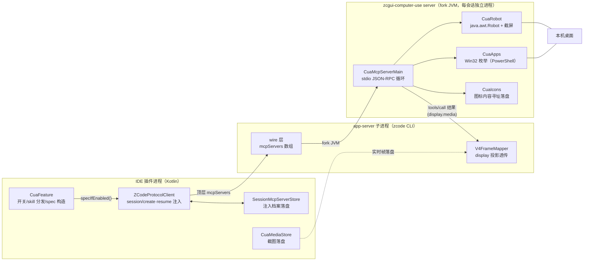

# 电脑控制（Computer Use）功能实现文档

> 版本基线：`feature/0.3.10`，主线提交 `89e9c0a4`（MVP+二期）+ `11510e42`（工具面扩容）。
> 功能开关默认**关**，位于设置页「电脑控制」。

## 一、功能概述

开启开关后，AI 获得对本机桌面的操作能力：枚举应用与窗口、截屏查看屏幕、移动鼠标点击、键入文本、发送按键、管理窗口位置尺寸、批量执行动作序列。AI 通过一组 MCP 工具（`mcp__zcgui-computer-use__*`）发起这些操作，插件负责把工具注入会话、驱动执行并把结果（截图/状态）渲染回聊天界面。

**为什么自建**：官方 ZCode 客户端的 computer-use 执行体在桌面客户端的闭源 Helper 进程里（代码签名门禁 + permission broker），CLI app-server 场景拿不到凭据，该能力在插件侧永远不可用——所以插件自建了完整的注入与执行链。

## 二、总体架构



分层原则：**插件进程不执行任何桌面操作**，只做开关管理、注入配置与结果渲染；执行本体在 app-server fork 的独立 JVM 子进程里，生命周期跟随会话（`isolation: "session"`，stdio 管道断即退出）。

## 三、模块与文件清单

| 文件 | 层 | 职责 |
|---|---|---|
| `intellij-plugin/.../cua/CuaFeature.kt` | Kotlin | 开关（PropertiesComponent 全局）、skill 装卸、McpServerSpec 构造、classpath 解析 |
| `intellij-plugin/.../cua/CuaMediaStore.kt` | Kotlin | 截图实时帧落盘 + 会话重载回填 |
| `intellij-plugin/.../cua/CuaMcpServerMain.java` | Java | server 主体：stdio JSON-RPC 循环、13 个工具实现、截图压缩、坐标台账 |
| `intellij-plugin/.../cua/CuaRobot.java` | Java | java.awt.Robot 封装：点击/拖拽/滚轮/键入/按键/粘贴 |
| `intellij-plugin/.../cua/CuaApps.java` | Java | 应用/窗口枚举（Win32 EnumWindows，经 PowerShell C# Add-Type） |
| `intellij-plugin/.../cua/CuaIcons.java` | Java | 图标 PNG 内容寻址存储（MD5 前 12 hex 作 key） |
| `intellij-plugin/.../cua/CuaKeymap.java` / `CuaMiniJson.java` | Java | 键名→VirtualKey 映射 / 手写极简 JSON |
| `protocol-client/.../SessionMcpServerStore.kt` | Kotlin | sessionId→mcpServers 磁盘档案（跨 IDE 重启回灌） |
| `protocol-client/.../ZCodeProtocolClient.kt` | Kotlin | create/resume 携带 mcpServers、内存会话档 |
| `webview/src/utils/cuaTools.ts` | TS | CUA 工具识别/短名/摘要/应用列表解析/会话引用判定 |
| `webview/src/components/CuaActionGroupCard.tsx` | TSX | CUA 动作聚组组卡 |
| `webview/src/components/CuaAppIcon.tsx` | TSX | 应用图标懒加载组件 |
| `webview/src/components/InputBox.tsx` | TSX | 「电脑操作」入口 chip 与常亮 |
| `intellij-plugin/src/main/resources/skills/zcgui-computer-use/SKILL.md` | 资源 | 随开关分发的使用技能 |

## 四、实现环节详解

### 环节 1：功能开关与技能分发

- 开关存 `PropertiesComponent`（机器级，非项目级），默认关。
- **开**：把内置 `SKILL.md` 复制到 `~/.zcode/skills/zcgui-computer-use/`（ZCode CLI 用户级技能目录，与用户自装技能同一扫描面）；**关**：删除 `SKILL.md`（目录内用户自建文件保留，目录因此清空时顺带移除——整目录删除会连带清掉用户自建/改写的同名 skill 内容）。工具面与技能同步装卸，避免「AI 看得到技能调不到工具」的中间态。这个文件同时是执行闸门的信号源（见环节 3）。
- 设置页另有子开关「在输入框显示电脑操作按钮」，主开关未开时禁用。

### 环节 2：会话注入（wire 配置与生命周期）

注入 = 新建会话时把 MCP server 配置随 `session/create` 顶层 `mcpServers` 数组发给 app-server：

```json
{
  "mcpServers": [{
    "name": "zcgui-computer-use",
    "command": "<IDE>/jbr/bin/java.exe",
    "args": ["-Djava.awt.headless=false", "-cp", "<插件目录>\\lib\\*",
             "com.zcode.ideaplugin.cua.CuaMcpServerMain"],
    "env": [],
    "isolation": "session",
    "timeoutMs": 300000
  }]
}
```

形状约束（协议 strict schema 实测定案）：

- **没有 `type`、`cwd` 字段**——照抄标准 MCP 配置文件的 `{"type":"stdio",...}` 直接 -32602；
- `env` 不是对象，是 `[{name,value}]` 数组；
- app-server 收到后按 command fork 子进程，通过 stdin/stdout 与之通信。

关键行为：

- 注入只在**新建会话**时读取开关；`session/resume` 必须携带与 create 相同的工具面（协议语义：不沿用等于绕过 create 的约束），插件自动处理（见环节 7）。
- 只有主界面建会话这一处注入。**定时任务与手机远程两条路径不注入**——后台无人监督的桌面控制明确不做。
- 权限模式跟随用户在会话底栏的选择（创建时恒 YOLO，用户可自行切换；CUA 的 MCP 工具调用在非 YOLO 模式下走插件既有权限审批弹窗）。

### 环节 3：MCP server 主体（纯 Java）

**为什么是纯 Java 而不是 Kotlin**：fork 的 JVM classpath 只有插件 jar 一个元素，而新版 IntelliJ 平台发行已无独立 kotlin-stdlib jar（modules 归档布局），Kotlin 代码在子进程里无法加载。server 侧全部用 Java 手写，JSON 用极简自实现（`CuaMiniJson`）。

**进程模型**：单线程读 stdin 逐行解析 JSON-RPC（`initialize` / `tools/list` / `tools/call` / `ping`），应答写 stdout；stdin EOF（app-server 死亡→管道断）即退出，无守护线程无残留。

**执行闸门（fail-closed）**：每次 `tools/call` 前现查 `~/.zcode/skills/zcgui-computer-use/SKILL.md`（插件开关的落盘投影，与插件侧 CuaFeature.skillDir 同一目录）是否存在，不存在一律拒绝并返回 `isError` 文本（code=DISABLED，说明功能已在 IDE 设置关闭、未执行任何桌面操作）。判据是文件不是目录——插件侧关闭只删 `SKILL.md`，目录可能因用户自建文件仍在。背景：注入面随会话存续无法中途撤销（resume 必须沿用 create 的工具面），server 进程也可能存活于开关关闭前的旧会话——「开关关闭=不再新建注入」由插件侧保证，「已注入会话立即断供」只能靠执行侧把关。文件即状态的跨进程投影，零 IPC，每调用现查不缓存，关闭即刻生效；文件被手动删除同视为关闭。

**编码纪律**：`System.out` 按管道默认编码走，中文 Windows 默认 GBK 而对端按 UTF-8 读——server 的 stdout/stderr 在写侧代码里钉死 UTF-8（`new PrintStream(..., UTF_8)`），不依赖启动参数。

**工具面（13 个）**：

| 工具 | 作用 |
|---|---|
| `list_apps` | 枚举可见应用（pid/前台标记/标题/图标 key） |
| `list_windows` | 枚举窗口（含隐藏窗口 class/rect/可见性） |
| `get_app_state` | 截屏（可 crop 子区域放大、可纯文本探针） |
| `left_click` / `left_click_drag` | 点击 / 拖拽（可带 expect_window_pid 护栏） |
| `scroll` / `type` / `key` / `paste` | 滚轮 / 键入（剪贴板+Ctrl+V）/ 按键 / 粘贴 |
| `window_manage` | 窗口原语：query/move/resize/focus/minimize/maximize/restore |
| `computer_batch` | 批量宏（≤20 步/30s，坐标全相对执行前截图，失败即停） |
| `request_access` / `stop_computer_control` | 权限确认 / 显式收尾 |

### 环节 4：桌面执行层

**坐标体系**：以 Java AWT 单空间为准（截图空间=点击空间，HiDPI 零换算）；AI 拿到的坐标是返回截图上的像素，server 用 CaptureLedger 台账（screenRect+图尺寸）反换算成屏幕坐标再派发——截图被压缩缩放后坐标依然准确。多屏布局下原点可为负（如左屏 [-3200,0]），不得假设 (0,0)。

**DPI**：Java 侧声明 per-monitor DPI aware；PowerShell 子进程默认 DPI-unaware，脚本内用「GetSystemMetrics/AWT 逻辑宽」的 ratio 自校验闭环换算，不假设 awareness 模式；混合 DPI 副屏为近似处理（主屏精确）。

**应用枚举**（`CuaApps`）：弃用 `Get-Process MainWindowTitle`（多窗口进程系统性漏报，实测 3 可见窗口只报 1），改 Win32 `EnumWindows` 全量枚举——C# 侧每个可见顶层窗口出一行（pid/是否前台/标题），过滤 DWM cloaked、无标题、过小窗口；PowerShell 侧按 pid 归并成一进程一条（标题取 Z 序最顶、前台窗口覆盖并标 active）。窗口标题经 `[Console]::OutputEncoding=UTF8` 保证中文完好。

**PowerShell 三坑**（均实测踩过，新脚本必守）：

1. 开放代码禁裸双引号——`powershell -Command` 会再走一层原生命令行解析把引号剥掉；治本 = `-EncodedCommand`（UTF-16LE base64），脚本零接触直达；
2. `Add-Type` 的 C# 编译引用必须显式 `-ReferencedAssemblies System.Drawing`（`-AssemblyName` 只加载会话不进编译引用集）；
3. Add-Type 单引号串内禁单引号字符字面量（会提前终止 PS 串），一律 `(char)NN` 代替。

**图标提取**：原生 Win32 路径（WM_GETICON/GCLP）拿到的 HICON 走 `Icon.FromHandle+ToBitmap` 会把 PowerShell **无异常硬崩**（进程消失零输出）；用 .NET 托管 `Icon.ExtractAssociatedIcon(exe)` 稳定（32×32 → PNG base64）。

**窗口管理语义原语**：有 OS API 的操作不做像素模拟（调窗口大小不走拖边缘）。动作后读回实际 rect 与请求比对（±2px），如实返回 `applied/clamped`，不静默假成功；`expect_window_pid` 护栏在点击/拖拽前用 WindowFromPoint 校验落点命中目标窗口，不符拒绝并报 GUARD_MISMATCH（防误点相邻窗口）。隐藏窗可达（focus 先 SW_SHOW 再 SW_RESTORE）、Win11 Store 应用双进程取有窗口的那个、操作目标必须 GA_ROOT 根窗口。

### 环节 5：截图回传与展示链

截图从 server 到用户眼睛要过四段链，**漏任何一段 = 工具卡只见占位文本**：

1. **server 侧压缩**：app-server 对 MCP 图片 content 有 200KiB base64 inline 预算，超限转 artifact 模型就看不到图——server 端 JPEG 压缩（≤1600px、质量逐级降，base64 ≤190K）；
2. **投影透传**：app-server 自动把 CUA 工具结果投影成 `result.display={kind:"cua",media:[...]}`，插件的帧归约器在两条 result 投影路径上透传 display（只取 output.text 会把图丢掉）；
3. **reducer 入态**：webview 事件归约把 media 提进 ToolPart.state，工具卡 header 行渲染缩略图（点击全屏预览）；
4. **落盘回填**：display.media 只活在实时帧，历史装配会剥成占位文本——`CuaMediaStore` 在实时帧流过时按 callID 落盘 `~/.zcode/cli/zcgui-cua-media/<会话id>/`，会话重载后按 callID 回填。配额：每会话 100 文件/单条 400K 字符。

动作类工具（点击/键入等）默认附执行后截图作为回执（`observe_delay_ms` 可配 0-5000ms，默认 400ms 等界面稳定），一次调用同时拿到「操作结果+操作后画面」。

### 环节 6：应用图标磁盘旁路

工具行前显示目标应用图标（对齐官方客户端），但**图标不走 MCP 图片 content**——那会 inline 进模型上下文吃 200KiB 预算和视觉 token。改为磁盘旁路：

- server 把图标 PNG 落 `~/.zcode/cli/zcgui-cua-icons/<md5前12hex>.png`（内容寻址，同图标免重写），工具结果里只带 12 位短 key（`icon=<key>` / JSON `icon` 字段）——模型零图零 token；
- webview 拿到 key 后经新桥 op `getCuaIcon`（key 白名单 `[0-9a-f]{12}` 防路径穿越）向插件取 base64，`CuaAppIcon` 组件懒加载渲染，store 缓存（缺失记 `''` 哨兵防重发）；
- 动作类工具自身无 app 信号，渲染时顺扫同消息最近一个 key 继承；
- 历史会话无 key（图标属低价值易失数据，不做持久化）。

### 环节 7：注入面跨重启持久化

真机实锤过的事故：注入记录原为 protocol-client 进程内存 map，IDE 重启后恢复会话时 resume 不带 mcpServers → 工具面丢失；且 CLI 对不存在的工具**只回空结果不报错**，模型无法自诊，被其他工具描述诱导陷入占位调用死循环（51 轮）。修复 = `SessionMcpServerStore`：

- create 带注入时落盘 `~/.zcode/cli/zcgui-session-mcp.json`（tmp+rename 原子写，损坏 fail-soft）；
- resume 内存未命中从磁盘回灌；
- closeSession 清档。
- 教训：会话级内存记录凡 resume/冷恢复要用的，必须假设进程会死。

### 环节 8：webview 渲染与入口

- **入口 chip**：输入框顶栏「电脑操作」按钮（显示=主开关开且子开关开），点击向输入框内联插入 `$zcgui-computer-use` 技能 chip；slash 候选懒加载未就绪时直发 `listCommands` 补插（走防抖缓存接口会拿到装技能前的旧列表而落空）。
- **常亮判定**（会话已进电脑控制上下文）：①输入框装了 CUA 技能 chip（编辑器 DOM 非 React 状态，用 MutationObserver 统一跟踪）；②AI 本会话真实使用过（回扫消息：Skill 调用 `input.skill` 命中，或 CUA MCP 工具有执行记录）。**用户消息文本提及技能名不算**——bug 报告、会话标题都会带这个名字，宽松子串实测误点亮。
- **工具卡友好渲染**：CUA 工具名显示短名（去 MCP 长前缀）；`list_apps`/`list_windows` 结果渲染为行式应用列表（图标+名称+pid+标题+前台徽标），解析失败回退原文；`cuaActionSummary` 把坐标/按键转语言中立摘要。
- **同名聚组**：连续同名 CUA 动作合并为一张组卡（图标+短名+次数+成员摘要+最新截图缩略图）。渲染有单卡/组卡双路径，工具卡功能必须两条路径都覆盖。
- **kv 水合竞态**：桥注入早于前端脚本时持久化状态在 render 前同步水合，init 里补挂的事件监听永远等不到——读持久值必须 `isKvHydrated()` 直读兜底+事件兜异步。

## 五、关键设计决策汇总

| 决策 | 原因 |
|---|---|
| 执行本体独立 JVM 子进程 | 插件进程不做桌面操作；会话级隔离，崩溃/退出不伤 IDE |
| server 纯 Java 零依赖 | fork JVM classpath 只有插件 jar，新版平台无 kotlin-stdlib |
| 截图走 display.media 投影 + 落盘回填 | 实时可见 + 重载存活，两头都要 |
| 坐标台账反换算（CaptureLedger） | 压缩截图后 AI 坐标=图上像素，server 统一换算 |
| 图标磁盘旁路（短 key） | MCP 图片 content 会吃 200KiB inline 预算，图标不该花模型的 token |
| 有 OS API 的操作走原语不模拟人手 | SetWindowPos 比像素拖边缘可靠一个量级 |
| 动作默认附回执截图 | 一次调用干两件事，真机实测轮次减半 |
| 执行闸门 fail-closed（SKILL.md 即开关投影） | 注入面随会话存续撤不掉，断供只能靠执行侧把关；文件即状态零 IPC |
| 输入走剪贴板 Ctrl+V | 绕开 IME 干扰，中文英文都稳 |

## 六、安全边界

**既有防护**：

- 开关默认关，不开则整个能力面不存在（不注入、不 fork、skill 不落盘）；
- 执行闸门：SKILL.md 被删（=开关关闭）后，任何到达 server 的工具调用（含关闭前已注入会话的存量调用）一律 fail-closed 拒绝，不执行任何桌面操作；
- server 无任何网络监听（纯 stdio），外部进程连不上，父进程死即退出；
- 定时任务、手机远程等无人监督路径不注入；
- Windows UIPI 天然边界：无法操作 UAC 提权界面，无法自我提权；
- 非 YOLO 权限模式下 CUA 工具调用走既有权限审批弹窗。

**需要知晓的风险面**：

- 截屏内容与窗口标题进入模型上下文，会随请求上传模型服务端；截图另以明文 PNG 落盘本地用户目录；
- YOLO 模式下点击/键入免审批直通（用户以底栏权限模式自行掌控）。

## 七、验证方法

- **随时可测（不经 IDE）**：裸起 server 进程 stdio 直驱——用安装目录 `lib\*` + IDE JBR java 起 `CuaMcpServerMain`，脚本逐个调工具。注意：裸 python subprocess 管道跑 PowerShell 会静默截死（退出码 0 无错误），**验证必须走生产同款 ProcessBuilder 链路**。
- **真机外部证据链**：idea.log（注入/skill 落盘日志）→ 进程命令行（JBR + `lib\*` 形态）→ 会话工具定义（工具面齐否）→ artifacts（截图落盘）→ `~/.zcode/cli/zcgui-cua-media/`（媒体档案）。
- **构建纪律**：改 Java 源后 `--skip-clean` 增量构建会被 daemon 假 UP-TO-DATE 打出旧包——`gradlew --stop` + 全量重建，出包后核包（解包 grep class 内新符号）。
- **验收清单**：开关联动 skill 装/卸；新会话注入与工具卡渲染；IDE 重启后恢复会话工具面仍在；关开关后已注入会话调用被拒（DISABLED）；配视觉模型跑截图→点击全循环；非 YOLO 模式权限弹窗路径。

## 八、已知边界

- **视觉模型是坐标闭环的前提**：当前编码套餐渠道只有纯文本模型，图到 provider 层被剥（工具结果呈 "Media omitted"）；需配自定义视觉渠道才能截图→点击全循环。技能文件已含降级指引（见 Media omitted 应引导换模型，不得盲点）。
- CLI 对已注入工具面的会话里**不存在的工具只回空结果**（服务端行为），模型无法自诊工具缺失——靠环节 7 的持久化杜绝工具面丢失来规避。
- 混合 DPI 副屏（如 2.0x）的 move/resize 为近似精度；窗口拒绝类边界（应用自钳制/失焦自动隐藏）在 SKILL.md 有指引，动作回执如实返回 applied:false。
- 修复媒体落盘之前的旧截图无档案、不可救回。
